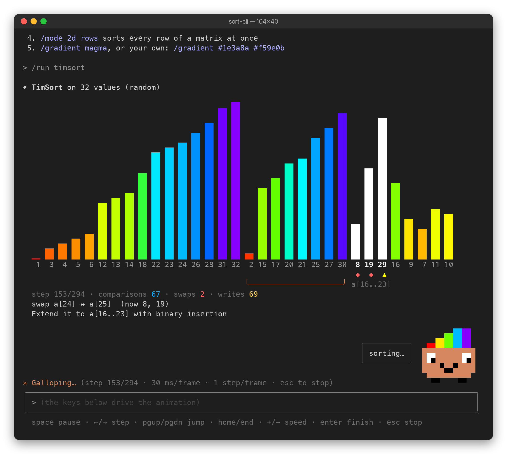
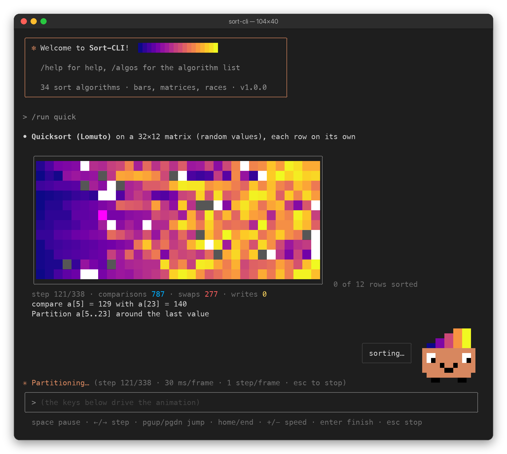
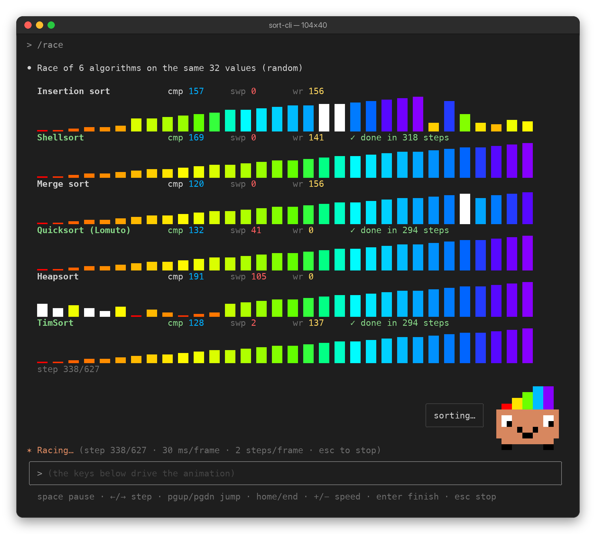

# Sort-CLI
Sort Algorithm Visualizations in the terminal, with a chat-style UI.

Sort-CLI (called SortVis up to version 0.6) animates 34 sorting algorithms as colored
bars or as a 2D heatmap. Since 1.0 it looks and works like Claude's CLI: a welcome box, a transcript of `⏺` replies with
`⎿` details, a bordered prompt with slash-command autocomplete, a spinner while an
animation plays, and a hint line under the prompt. Every run can be paused and
stepped forwards **and backwards**, one comparison, swap or write at a time.

Type a slash command, or just ask: `timsort`, `race quick merge heap`,
`explain smooth`, `reversed 40`, `2d rows`.

## Algorithms
| Category     | Keys |
|--------------|------|
| exchange     | `bubble`, `cocktail`, `oddeven`, `comb`, `gnome`, `exchange`, `circle`, `quick` (Lomuto), `hoare`, `quick3` (3-way), `dualpivot` |
| selection    | `selection`, `dselection`, `heap`, `smooth`, `cycle`, `pancake` |
| insertion    | `insertion`, `binsertion`, `shell` |
| merge        | `merge`, `bmerge` (bottom-up), `timsort` |
| hybrid       | `intro` |
| distribution | `counting`, `radix` (LSD), `msd`, `bucket` |
| network      | `bitonic`, `batcher` (odd-even merge) |
| slow         | `stooge` (≤ 64 values), `slowsort` (≤ 32), `bogo` (≤ 7) |
| 2D           | `shear` (matrix only, ends in snake order) |

`/algos` lists their costs and stability, `/explain <algo>` gives a summary,
complexity and pseudocode.

TimSort is a port of Java's `java.util.TimSort`: natural runs (descending ones are
reversed), binary insertion up to minrun, a run stack kept balanced, and merges that
switch to galloping. It uses MIN_MERGE 16 instead of Java's 32 (CPython: 64) so that
runs and merges show on arrays small enough to watch; `/data runs` shows it best.

## What you see
* **Bars** (`/mode 1d`): the values just compared are white with `▲` under them, a
  swap or write shows `◆`, the pivot is magenta with `P`, values in their final place
  get a green `━`, and `╰──╯` marks the part being worked on. Below: live comparison,
  swap and write counts, the current action (`compare a[3] = 7 with a[4] = 2`) and
  the algorithm's own note (`Merge runs a[0..15] and a[16..31]`).
* **Matrix** (`/mode 2d`): values as a heatmap. By default every row is sorted on
  its own, all rows at once, each finishing when its own data allows (`rows`). `cols`
  does the same per column, `flat` sorts the matrix as one sequence in reading order
  and `snake` in snake order.
* **Race** (`/race a b c`): up to 8 algorithms on the same data, stacked; each lane
  finishes when its algorithm does, and the finish order is reported.
* **Compare** (`/compare`): no animation, a table of comparisons, swaps, writes,
  array accesses and stability on the current data for every algorithm.

After a run Sort-CLI checks the result is sorted and whether equal values kept their
original order (`/data dups` makes that visible).

**Bitsy**, an orange bar critter, lives above the prompt (Search-CLI has Hoot the owl).
It carries five bars in the current gradient and bubble-sorts them while a sort
plays, cheers "sorted ✓" when a run finishes, says "oops" after an error or a
stopped run, blinks while idle and dozes off after a minute without keys. It hides
in windows smaller than 60×22, in piped mode, and with `/pet off`.

## Commands
| Command                          | What it does |
|----------------------------------|--------------|
| `/run [algo]`, `/step [algo]`    | Run a sort; `/step` starts paused |
| `/race [algo …]`                 | Several sorts side by side (default: insertion, shell, merge, quick, heap, timsort) |
| `/compare [algo …]`              | Work counts for all (or some) algorithms |
| `/explain [algo]`, `/algos [category]`, `/use <algo>` | Learn about and pick algorithms |
| `/data [kind] [n\|WxH]`          | New samples: `random`, `sorted`, `reversed`, `nearly`, `few`, `dups`, `runs`, `sawtooth`, `organ` |
| `/data v1 v2 …`                  | Sort your own values |
| `/size <n>\|<WxH>`, `/mode 1d\|2d [rows\|cols\|flat\|snake]`, `/show` | Size, layout (2D defaults to rows sorted at once), current samples |
| `/seed [n\|random]`              | Every set of samples has a seed; the same seed, kind and size give the same samples |
| `/gradient [preset [reverse]\|reverse\|colors…]` | 17 presets shared with Search-CLI: `rainbow` and `pastel` (from SortVis 0.6), `viridis`, `plasma`, `inferno`, `magma`, `cividis`, `turbo`, `ocean`, `fire`, `sunset`, `forest`, `ice`, `candy`, `cool`, `claude`, `grayscale`; or your own 2-18 stops: `/gradient #1e3a8a #f59e0b #fef3c7` (`#rrggbb`, `#rgb` or xterm 0-255) |
| `/color [256\|truecolor]`        | 24-bit color is used when `COLORTERM` says the terminal supports it |
| `/speed [ms]`, `/duration [s]`   | Milliseconds per frame (default 30); longest a run takes (default 12 s) before frames skip steps |
| `/pet [on\|off]`                 | Show or hide Bitsy |
| `/clear`, `/help`, `/exit`       | |

## Controls
* `/` opens the command menu; `↑`/`↓` choose, `Tab` completes, `Enter` runs.
  Algorithm names, data kinds, layouts, gradients and categories complete too.
* `↑`/`↓` with no menu open walk through your history; `?` shows shortcuts.
* `Ctrl-A`/`Ctrl-E`/`Ctrl-U`/`Ctrl-K`/`Ctrl-W` edit the line, `Esc` clears it,
  `Ctrl-L` redraws, `Ctrl-C` twice or `Ctrl-D` exits.
* While a sort plays: `space` pause/resume, `←`/`→` one step, `PgUp`/`PgDn` jump,
  `Home`/`End`, `+`/`-` faster/slower, `Enter` jump to the result, `Esc` stop.

## Building
```bash
make                # or: mingw32-make on Windows
```
or compile directly:
```bash
cc -O2 -std=c99 sort-cli.c -o sort-cli -lm
```

## Usage
```
sort-cli [OPTIONS]

OPTIONS:
  -v, --version          Display program version information
  -h, --help             Display this help message
  -s, --speed <ms>       Milliseconds per animation frame (default: 30, range 5-2000)
      --seed <n>         Seed for the samples, for reproducible runs
  -g, --gradient <name>  Color gradient preset (rainbow, viridis, plasma, magma, turbo, ...)
      --truecolor        Smooth 24-bit gradients (default when COLORTERM=truecolor)
      --256              Use the 256-color palette
      --no-color         Plain output (also when NO_COLOR is set)
```

Requests can be piped in, one per line; each result is then printed without
animating:
```bash
printf '/data dups 24\n/compare\n' | ./sort-cli --seed 42
```

## Testing
```bash
make test
```
`test.c` runs everything without the UI (under a second) and checks that:
* every algorithm sorts every sample kind at sizes 1 to 257 (and 2048 for the
  n log n ones), the output is a permutation of the input, and algorithms marked
  stable keep equal values in order
* the recorded steps replay to exactly the result, the counters match the steps,
  and seeking to any step (backwards included) matches a fresh replay
* TimSort finds runs, merges and gallops, and does n − 1 comparisons on sorted or
  reversed input; shear sort ends in snake order; 2D layouts cover every cell
* every frame fits windows from 50 to 200 columns, gradient presets, stops and
  reversing work in 256 and 24-bit color, Bitsy draws every mood at 14×6 and hides
  when it should, and every command and plain request answers without errors

The random inputs use a seed printed at the top of the report; pass it back to
reproduce a run:
```bash
./sort-cli-test 1234
```

## Code layout
| File          | Contents |
|---------------|----------|
| `term.h`      | raw keyboard input with timeouts, window size, output |
| `text.h`      | string builder, colors, markup and word wrap |
| `gradient.h`  | gradient presets and custom stops, truecolor or nearest xterm-256 (same file as Search-CLI) |
| `data.h`      | seeded random numbers and sample generators |
| `trace.h`     | the helpers algorithms call, step recording and replay with checkpoints |
| `algs.h`      | the algorithms and their descriptions |
| `view.h`      | lanes and layouts; bars, heatmap and race drawing |
| `ui.h`        | transcript, live region, spinner and the player |
| `pet.h`       | Bitsy: sprite, moods, speech bubble, the strip above the prompt |
| `cmds.h`      | commands, plain requests, autocomplete, line editor, main loop |

Algorithms never draw: they record their comparisons, swaps and writes, and the
player redraws any step on demand.

## Notes
Tested on macOS (Apple Clang 21). Linux should work as is (`-lm` is in the makefile).
The Windows code path (console VT mode, `_getch` input) follows SortVis 0.6 but has
not been tested with this version.

**Requirements:**
* macOS or Linux with a UTF-8, 256-color terminal
* Windows 10 Build 10586 or later (for VT/ANSI support)

## Screenshots




## Changes
Please see [sort-cli.c](sort-cli.c)
